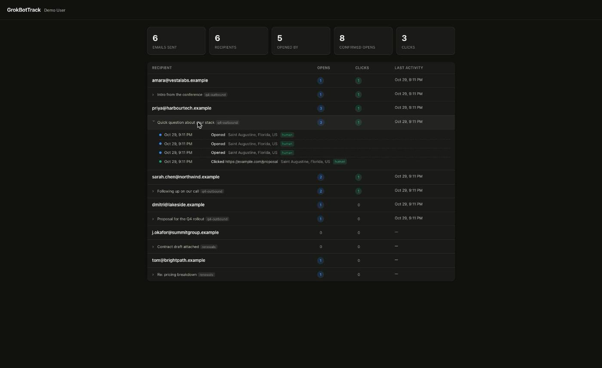
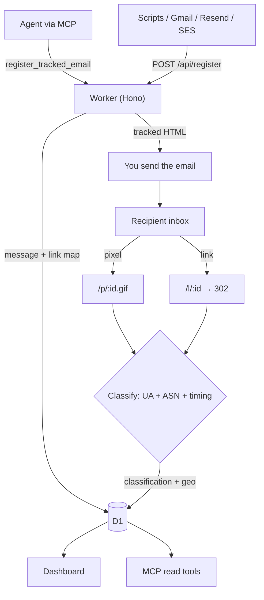

# MailTrackMCP

**Self-hosted email open & click tracking that your AI agent can query.**
One Cloudflare Worker + D1. No server, no per-seat SaaS fee, free tier is plenty.

[](https://deploy.workers.cloudflare.com/?url=https://github.com/headlessfounder/MailTrackMCP)

One click and you have your own copy: Cloudflare clones this repo into your
GitHub or GitLab account, **creates the D1 database for you**, binds it, and
deploys. Then open `/setup` on your new Worker to create the first account —
it creates the database tables on first visit too. No CLI required.

Prefer the command line, or want it in an existing repo? See
[Quick start](#quick-start).



---

## Why this exists

Email trackers are a crowded space. Two things here are not:

**1. It ships an MCP server.** Connect it to any MCP-capable agent — Claude, Cursor, Grok, OpenClaw — and ask *"who opened my emails today?"* — or have the agent
register and send tracked mail itself. Tracking that an agent can both **write
to** and **reason over**.

**2. It tells you when an "open" isn't a read.** Most trackers count every pixel
hit. Mail clients and security appliances fetch pixels constantly, which is why
naive open rates are inflated. MailTrackMCP classifies every event and excludes
the noise — see [Trust model](#trust-model).

Because tracking is injected **server-side at send time**, it works for any
sender — agents, Gmail, Resend, SES, scripts — instead of needing a browser
extension.

## Features

- **Open tracking** via an invisible 1×1 GIF, injected at the top of the body so
  Gmail's ~102KB clipping can't silently kill it
- **Click tracking** by rewriting links to logging redirects (302 to the real URL)
- **Event classification** — `human`, `gmail-proxy`, `apple-prefetch`, `scanner`,
  `sender-echo`
- **Geolocation** from Cloudflare's edge, surfaced only when it's genuinely the
  reader's
- **Multi-user** — personal API tokens, isolated data per person
- **Dashboard** — per-recipient rollups with expandable event timelines
- **Passwordless login** — magic link, no passwords stored
- **Engagement alerts** — email on a recipient's first genuine open or click
- **MCP server** — four tools over Streamable HTTP

## Quick start

The manual path, if you'd rather not use the button above.

```bash
git clone https://github.com/headlessfounder/MailTrackMCP && cd MailTrackMCP
npm install

npx wrangler d1 create mailtrackmcp      # put the printed id in wrangler.jsonc
npm run db:init                        # create the tables
npx wrangler deploy
```

Then open **`https://<your-worker>.workers.dev/setup`** and create the first
account. That page disables itself once an account exists, and hands you the API
token agents authenticate with.

Set `ADMIN_TOKEN` and `SESSION_SECRET` as secrets to enable adding teammates and
magic-link sign-in — see `.dev.vars.example` for the full list:

```bash
npx wrangler secret put SESSION_SECRET   # openssl rand -hex 32
npx wrangler secret put ADMIN_TOKEN
```

### Optional but recommended

**Custom tracking domain.** Serve pixels and links from a subdomain of the domain
you *send from* (`go.yourdomain.com`). Matching domains keep spam filters calm —
links pointing somewhere unrelated to the From address is a phishing signal.
Uncomment `routes` in `wrangler.jsonc`, set `TRACKING_HOST`, redeploy.

**Email (for login links and alerts).** Enable Cloudflare Email Sending once:

```bash
npx wrangler email sending enable yourdomain.com
```

Set `NOTIFY_FROM` to an address on that domain. Prefer Resend instead? Set a
`RESEND_API_KEY` secret and it takes over — no code change.

```bash
npx wrangler secret put SESSION_SECRET   # any long random string; enables login
```

## Using it

**The one rule: register before sending, then send the returned HTML unmodified.**
It already contains the pixel and rewritten links.

```bash
curl -X POST https://<your-worker>/api/register \
  -H "Authorization: Bearer dt_YOUR_TOKEN" \
  -H "content-type: application/json" \
  -d '{
    "recipient": "them@company.com",
    "subject": "Quick question",
    "campaign": "q4-outbound",
    "agent_source": "your-agent",
    "html": "<html><body><p>Hi — see the <a href=\"https://example.com/demo\">demo</a>.</p></body></html>"
  }'
```

Send the `html` from the response. Set `campaign` and `agent_source` so stats stay
comparable across every tool you send from.

### Connect an agent (MCP)

Point any MCP-capable agent at `/mcp`:

```json
{
  "mcpServers": {
    "mailtrackmcp": {
      "type": "http",
      "url": "https://<your-worker>/mcp",
      "headers": { "Authorization": "Bearer dt_YOUR_TOKEN" }
    }
  }
}
```

Client can only launch stdio servers? Bridge it:

```json
{
  "mcpServers": {
    "mailtrackmcp": {
      "command": "npx",
      "args": ["-y", "mcp-remote", "https://<your-worker>/mcp",
               "--transport", "http",
               "--header", "Authorization: Bearer dt_YOUR_TOKEN"]
    }
  }
}
```

Verify the connection — this should list four tools:

```bash
curl -s -X POST https://<your-worker>/mcp \
  -H "Authorization: Bearer dt_YOUR_TOKEN" \
  -H "content-type: application/json" \
  -d '{"jsonrpc":"2.0","id":1,"method":"tools/list"}'
```

| Tool | Arguments | Returns |
|---|---|---|
| `register_tracked_email` | `recipient`, `html`, `subject?`, `campaign?`, `agent_source?` | `message_id` + `tracked_html` to send verbatim |
| `list_recent_emails` | `limit?` | Sends with `confirmed_opens`, `raw_opens`, `clicks`, `last_human_activity` |
| `get_email_status` | `message_id` | Event timeline: type, time, location, classification |
| `get_campaign_stats` | — | Per-campaign emails, recipients, opens, clicks |

Then just ask your agent:

- *"Who opened my emails today?"*
- *"Has anyone at Northwind clicked the proposal link?"*
- *"Which campaign has the best open rate?"*
- *"Send this to sarah@example.com and track it."*

The full integration contract — including Gmail drafts, failure handling, and
how agents should report classifications honestly — is in
**[AGENTS.md](AGENTS.md)**.

### Adding more people

The first account comes from `/setup`. Add teammates with the admin token
(`npx wrangler secret put ADMIN_TOKEN` first):

```bash
curl -X POST https://<your-worker>/api/admin/users \
  -H "x-admin-token: $ADMIN_TOKEN" \
  -H "content-type: application/json" \
  -d '{"name":"Jane Smith","email":"jane@yourdomain.com"}'
```

Each person gets their own token, their own isolated data, and their own
dashboard. Agents using one person's token only ever see that person's sends.

## Trust model

Not every pixel fetch is a human reading your email.

| Signal | Classification | Counts as open? | Location trustworthy? |
|---|---|---|---|
| Normal client | `human` | ✅ | ✅ |
| `GoogleImageProxy` UA | `gmail-proxy` | ✅ | ❌ — it's Google's datacenter |
| Gmail proxy within `SELF_OPEN_WINDOW_SEC` of send | `sender-echo` | ❌ | ❌ |
| Apple/iCloud ASN < 5 min after send | `apple-prefetch` | ❌ | ❌ |
| Datacenter ASN or scanner UA < 60s | `scanner` | ❌ | ❌ |

`confirmed_opens` = `human` + `gmail-proxy`. Clicks count only when `human`.

**Trust ladder:** a human *click* is strongest (real person, real location) >
human open > gmail-proxy open (real, but location is Google's) >
`sender-echo` / `apple-prefetch` / `scanner` (excluded).

**Why `sender-echo` exists:** re-reading your own message in Sent fetches the
pixel through the same Gmail proxy as the recipient's open — the two are
indistinguishable by request alone. A real open seconds after send is rare; a
sender reviewing their own copy is not, so that window is attributed to you
rather than inflating your numbers. Tune with `SELF_OPEN_WINDOW_SEC`.

## Routes

| Route | Auth | Purpose |
|---|---|---|
| `POST /api/register` | Bearer | Inject pixel + rewrite links, return tracked HTML |
| `GET /p/:id.gif` | none | Log open, return 1×1 GIF |
| `GET /l/:id` | none | Log click, 302 to the stored destination |
| `GET /api/summary` | Bearer / session | Per-message rollup |
| `GET /api/messages/:id/events` | Bearer / session | Event timeline |
| `POST /mcp` | Bearer | MCP server (JSON-RPC 2.0) |
| `GET /app` | session or token | Dashboard |
| `GET /setup` | first run only | Create the first account |
| `POST /api/admin/users` | `x-admin-token` | Add further users |

## Architecture



## Data model

- **users** — `id, name, email, api_token, created_at`
- **messages** — `id, user_id, recipient, subject, campaign, agent_source, sent_at`
- **links** — `id, message_id, original_url` *(destinations stored server-side;
  the redirect never trusts a URL from the query string)*
- **events** — `id, message_id, link_id, type, ts, ua, ip, country, region, city,
  timezone, classification`
- **login_tokens** — single-use magic-link tokens

## Cost

Fits the Cloudflare **Workers Free** tier (100K requests/day, 5 GB D1) — each open
or click is one request. Past that, Workers Paid is $5/mo.

## Responsible use

Email tracking is a real privacy consideration, not a neutral one.

- Intended for **business correspondence you have a legitimate reason to send**,
  not surveillance of individuals.
- Many jurisdictions (GDPR/ePrivacy among them) expect disclosure that you track
  opens. A line in your privacy policy usually covers normal business outbound —
  **check what applies to you.**
- Recipients can defeat tracking by blocking remote images, and that's their right.
  Treat missing opens as missing data, not as a problem to engineer around.
- Don't use this for bulk unsolicited mail. Beyond being unpleasant, it will
  destroy the sending reputation of the domain you worked to build.

The classification system exists partly for this reason: honest numbers you can
act on beat inflated ones that flatter you.

## Security

Set `ADMIN_TOKEN` before sharing your Worker URL: `/setup` is open while the
instance has no accounts, and the token closes that window. Full notes, and what
the system does and doesn't protect against, are in [SECURITY.md](SECURITY.md).

## Troubleshooting

| Symptom | Likely cause |
|---|---|
| `401` from the API or MCP | Token missing, wrong, or not prefixed with `Bearer ` |
| MCP connects but returns no data | Wrong user's token — data is scoped per token |
| Sign-in says "not configured" | No email provider, or `SESSION_SECRET` unset |
| Sign-in link never arrives | Address doesn't match an account. The endpoint replies identically either way so it can't be used to enumerate users |
| Opens never register | Recipient blocks remote images — common and legitimate. Use clicks as your signal |
| Opens look inflated | Check classifications; `confirmed_opens` already excludes scanners and prefetches |
| Your own reads show as opens | Raise `SELF_OPEN_WINDOW_SEC` |
| Links look wrong in sent mail | `TRACKING_HOST` unset or not matching the deployed custom domain |
| `/setup` returns 403 | An account already exists — that page self-disables |

## Development

```bash
npm run dev         # local worker
npm run typecheck   # tsc --noEmit
npm run deploy      # ship it
```

Keeping deployment-specific settings out of git? Put them in
`wrangler.local.jsonc` (gitignored) and run `npm run deploy:local`.

## License

MIT — see [LICENSE](LICENSE).
